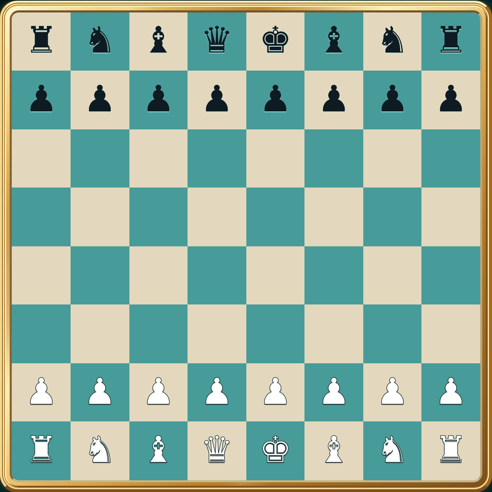
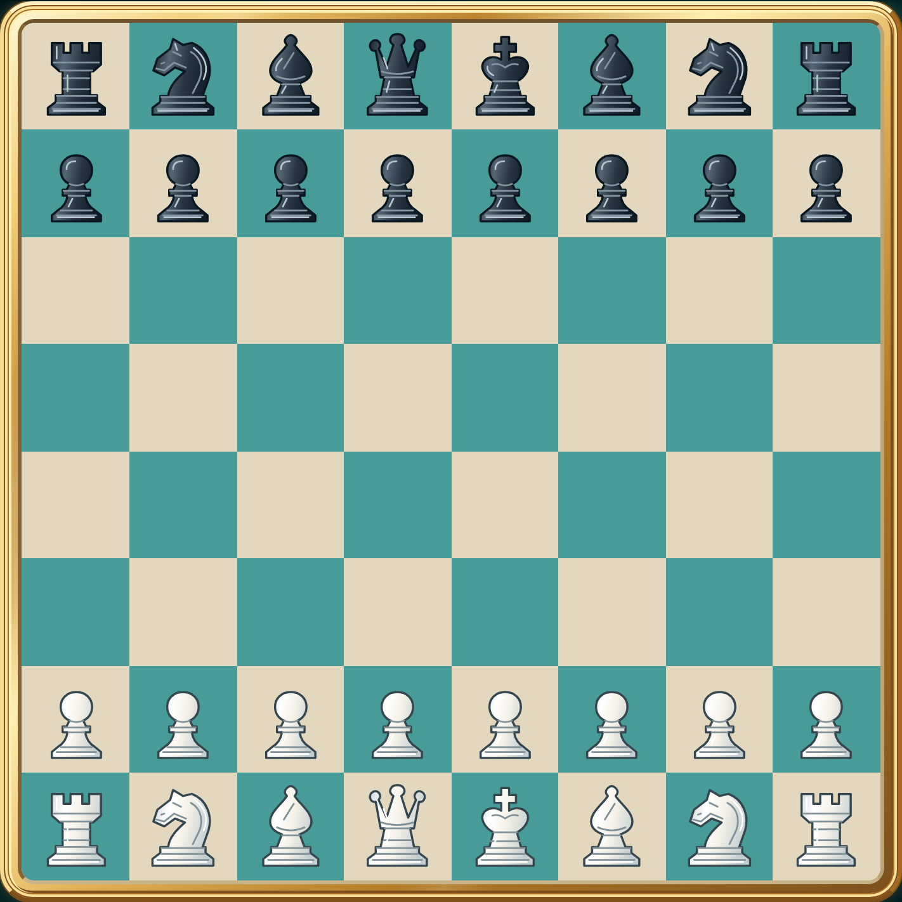
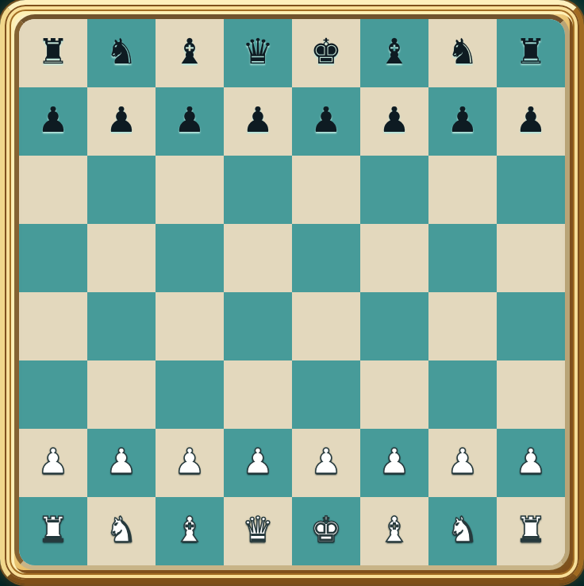
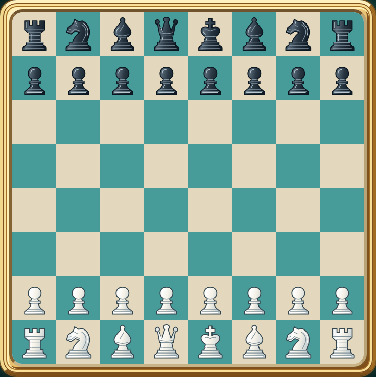

# #741 — original premium chess SVG acceptance

Original Gracz.pl vector paths authored for this change, without third-party artwork, fonts, images, filters or new dependencies. Six silhouettes and two opaque palettes produce twelve SVG variants through `createElementNS`. The same renderer serves board cells and promotion buttons in the existing console. Rules, engine, clocks, authentication, WebSocket and database logic are unchanged.

Screenshots below are real Chromium board crops at device scale factor 2, using the original console locally. Before: main `28ecf80513f5c4e08f552936a8f1c93cd3eec2e9`. After: this branch. No mockup or image generation.

| Viewport | Before | After |
| --- | --- | --- |
| 1600×900 |  |  |
| 390×844 |  |  |

Verified locally (Node 24.19.0, system Chromium, disposable PostgreSQL 16 and Valkey 8):

- Baseline chess console: **15/15 PASS**.
- Twelve SVG variants and integration: **2/2 PASS**; missing module and leftover chess font were observed failing before implementation/fix.
- Full unit suite: **638/638 PASS** (before adding the second renderer assertion; that assertion separately passes).
- Two Chromium chess sessions: **PASS**, 7 clicked moves through checkmate, computer play, clocks, WebSocket-only synchronization and reconnect. Positions compare actual SVG piece/color and empty cells against authoritative state.
- Renderer acceptance: **PASS**, 1600×900 and 390×844 at 2×; all twelve identities, opaque bodies, bounds, centering, unique gradient IDs, lobby, keyboard moves, capture markers, focus, keyboard-activated fullscreen, reversed orientation, and all four promotions for both colors. Polish square labels remain on native buttons; decorative SVGs are hidden from assistive technology.
- Existing multiplayer scaling checks: **7/7 PASS**; persistence suite: **143/143 PASS** (completed before the follow-up mandate; not repeated).
- Syntax check and production import manifest gate: **PASS**.

The new renderer browser test is included in the existing Multiplayer scaling CI workflow. To reproduce, use its existing Playwright installation and run:

```sh
node --test contact-api/scaling/chess-pieces.browser.test.mjs
```

Optionally set `CHESS_SCREENSHOT_DIR` to save full-console and capture-selection screenshots. Promotion and orientation fixtures substitute only the test browser's module responses; production contains no test hooks. Fullscreen is activated with the keyboard, preserving the existing console geometry.

Draft only: owner review is required before merge or deployment.
